<div align="center">


</div>

```console
Mahee-dot@github:~/profile$ whoami
Mahi · Computer Engineering student

Mahee-dot@github:~/profile$ cat about.txt
I build software, mostly AI-flavoured,
and I care about the problem more than the stack.

Mahee-dot@github:~/profile$ cat goals.txt
[ ] Learn something new every week
[ ] Finish and share more projects
[ ] Get better at understanding AI
```


## ABOUT

```yaml
status    : 2nd year, Computer Engineering
interests : Artificial Intelligence, Full stack development
competing : hackathons and technical competitions
learning  : GenAI
```

## STACK

| | |
|---|---|
| **Languages** | `Java, C, HTML, CSS, Python` |
| **Web & backend** |      |
| **AI & ML** | `[ADD LIBRARIES / MODELS / APIS]` |
| **Tools & platforms** |  `[ADD TOOLS]` |

<!-- Add a badge:  -->


## ACTIVITY

<div align="center">
<picture>
  <source media="(prefers-color-scheme: dark)" srcset="https://raw.githubusercontent.com/Mahee-dot/Mahee-dot/output/github-snake-dark.svg" />
  <source media="(prefers-color-scheme: light)" srcset="https://raw.githubusercontent.com/Mahee-dot/Mahee-dot/output/github-snake.svg" />
  
</picture>
</div>

## STATS

<div align="center">

<br /><br />

</div>

<br />

<div align="center">



<sub>`$ git commit -m "Dark mode, because light attracts bugs."`</sub>

<sub>Thanks for stopping by. Let's build something useful.</sub>

</div>

